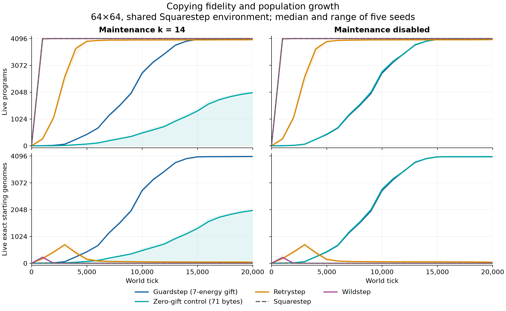

# Guardstep: copying fidelity under interference

- **Question and scope:** Can retrying, verifying and provisioning a child preserve copying fidelity under v0.4.0? Guardstep comparison in a shared 64×64 environment, including single-founder and mixed-population assays.
- **Answer:** Ten single-founder 20,000-tick runs across five seeds, with maintenance k=14 or disabled, produced 40,734 exact births and only exact surviving genomes; all recorded zero mutations. In five mixed worlds per competitor, Guardstep produced no exact descendants with Squarestep and only one descendant in one Wildstep world. Foreign early boots and late writes supply explicit failure cases.
- **Meaning:** The 71-byte design repairs the [observed copying failures](2026-10-28_reproduction-fidelity.md) in its tested single-founder setting. It uses ordinary VM instructions, but does not establish an evolutionary path to reliable reproduction.
- **Limits:** This is neither universal interference tolerance nor a minimum-complexity result. No abiogenesis or evolutionary-path experiment was performed.
- **Disposition:** Closed; developmental repair ideas are parked. [Compact evidence and runnable inputs](reliable-copying/README.md) are retained; original bulk archives are unavailable. Reopen only for a selected question about emergence or a new causal mechanism.

[Chapter synthesis](README.md#copying-and-guardstep-chapter-closed).

Guardstep retries missing bytes, abandons a target whose length differs from its
construction progress, funds the unfinished body, and compares every byte before
booting. Use the [example manifest](reliable-copying/README.md) to run it.

## Protocol and invariants

The [exact genomes](reliable-copying/genomes.json) are the source for the
mechanistic assays. Guardstep's phases are:

| Byte offsets | Operations | Purpose |
| --- | --- | --- |
| 0–3 | `cw; move; push 0; setDst` | Seek another site and reset construction progress. A failed move still proceeds to inspect the adjacent site. |
| 4–14 | `absorb; collect; senseSize; getDst; eq;` conditional restart | Reject a target whose length differs from the number of successful appends. |
| 15–18 | `getDst; setSrc; read; appendAdj` | Attempt the next byte of the parent's code. |
| 19–23 | `getFlag; not; getDst; add; setDst` | Increment progress by one on success and by zero on failure. |
| 24–36 | Compare progress with own size; branch back to 4 | Continue until the full body has been appended. |
| 37–42 | `push 7; giveE; push 0; setSrc; getSize; for` | Give the body up to seven free energy, then start the verification scan. |
| 43–48 | `read; getSrc; push 1; sub; setSrc; readAdj` | Read the same byte index from parent and target. |
| 49–61 | Save the read outcome in `Dst`; compare bytes; reject failure or mismatch; `next` | Verify every byte, using `Src` as the scan position and `LC` as the remaining count. |
| 62–70 | `push 0; giveE; senseSize; getSize; eq; push 2; swap; jmpZ; boot` | Yield, recheck target length, and boot only when it still matches. |

The restart branches use `getIP; push 5; add; neg; swap; jmpZ`. At a `getIP`
address of g, the jump is at g+5, so its offset −(g+5) returns to byte 0.
The copy-loop branch synthesizes −32 and jumps from byte 36 to byte 4. The final
conditional jump at byte 69 skips `boot` and wraps to byte 0 on a length mismatch.
Every ordinary path leaves the data stack empty between construction iterations.

`getFlag` immediately follows `appendAdj` and `readAdj`: normal stack/register
instructions clear the flag, so consulting it later would lose the outcome.
An unsuccessful append does not advance `Dst`; the next attempt reloads the
same parent byte. A failed adjacent read cannot pass merely because it returned
zero and the expected byte also happened to be zero.

The final zero-valued `giveE` is a scheduling boundary. It consumes no resource
and yields until the next tick. The subsequent size check uses six local actions
before `boot`, which fits the tested budgets of eight actions at alpha=0.5 and
ten at alpha=0.55 for this genome. Thus that check and boot queueing occur in one
Pass 1. This property is not guaranteed at smaller action budgets or after code
changes. Earlier construction sensing can span ticks; the recovery assay
deliberately exercises a target moving in after the empty-cell reading.

Seven energy is a requested transfer, not a guaranteed balance: `giveE` transfers
what the parent can afford. Funding lets the inert body pay maintenance while
the parent spends many ticks verifying it. A successful append refreshes the
inert grace timer; a read does not. The 71-byte zero-gift control changes only the requested amount from seven to
zero, preserving code length, local budgets and the scheduling boundary. The
earlier 69-byte unfunded prototype omits the transfer instruction pair entirely;
its timing differs and it is reported separately.

## What the protocol establishes

In an uncontested construction with an unchanged parent and body, the copied
bytes are exact and failures caused by temporary mass shortage can be retried.
Unexpected growth or shrinkage during construction is grounds to abandon that
body. Corruption present when its byte is checked is rejected. Growth after the
scan is rejected by the final length check if it precedes that check.

These checks do not make verification atomic. A foreign write to an earlier
byte after it has been read can evade the scan without changing length. Another
actor can boot the body before its creator verifies it. A permanently protected
target can keep an append failing; the seed has no liveness sensor or retry
deadline. Parent mutations, live edits and resource/space constraints also remain
part of the ecology. These are protocol limits, not promises delegated to an
observer or a changed engine rule.

## Controlled interference assays

The [Rust assays](../../rust/tests/reliable_copying.rs) use ordinary programs for
the interfering actions, including delayed mass donation. The world has no
ambient arrivals. Maintenance is disabled except in the explicit erosion assay
(k=4); mutation exponents are 63/63 and the audit-based assays assert zero actual
mutations. The parent has ample energy. Interference fixtures start at the copy
entry; positive controls and population runs start at IP 0.

| Condition | Observed protocol behavior |
| --- | --- |
| Funded, isolated parent | Guardstep, Retrystep, Squarestep and Wildstep all produce an exact first offspring. |
| Parent has one mass; donor arrives after 40 ticks | Guardstep and Retrystep survive actual failed appends and complete an exact body. Squarestep and Wildstep first boot partial bodies. |
| Foreign append during construction | Guardstep rejects the affected body and subsequently reproduces elsewhere. |
| Same-length foreign write before that byte is checked | The byte scan rejects the affected body and the parent subsequently reproduces. |
| A mover occupies and protects a target after it was sensed empty | The append fails; Guardstep detects the unexpected length and reproduces elsewhere. |
| Foreign append after the scan, before the final size check | Guardstep rejects the body. |
| Maintenance k=4 exhausts the gift and erodes the body | The parent rejects the body and starts another construction. |
| Foreign boot during construction | The foreign actor animates a partial Guardstep body. |
| Foreign write to byte 0 after byte 0 was checked | Guardstep itself boots an incorrect, same-length body. |

The last two interference cases retain reproducible counterexamples. Finite
interference rejection tests also require successful later reproduction. The
separate k=4 erosion assay requires the parent to restart construction and checks
that any births are exact; it does not require reproduction under that persistently
hostile maintenance regime.

## Paired population comparison

All compared organisms share the Squarestep environment: 64×64, root at
`(32,32)` with zero free energy/mass, arrival rates 0.5 energy and 0.3 mass,
decay exponents 7, local exponent 0.55, `t_cap` 4, inert grace 10, no spontaneous
spawning, and mutation exponents 63/63. Maintenance is either k=14 or disabled.
Seeds 1–5 are paired within each condition. Wildstep is tested in this shared
environment rather than its separately verified library regime.

The complete comparison records starts, births, abandoned-body deaths and
unfinished bodies as well as exact births and surviving original genomes.
Exact birth means a byte-for-byte match to the starting genome, which is stricter
than matching a creator that may already have changed. Census occupancy is
reported separately from fidelity.

The table pools births across five seeds; population columns give the per-seed
minimum and maximum at tick 20,000. All 60 single-founder runs recorded zero
mutations. The full [comparison rows](reliable-copying/comparison.csv) preserve
each seed and every construction outcome.

| Organism | Maintenance | Live programs | Exact starting genomes alive | Exact / all births, five seeds |
| --- | --- | ---: | ---: | ---: |
| Guardstep, 71 bytes | k=14 | 4,075–4,080 | 4,075–4,080 | 20,382 / 20,382 |
| Guardstep, 71 bytes | off | 4,065–4,083 | 4,065–4,083 | 20,352 / 20,352 |
| Zero-gift control, 71 bytes | k=14 | 2–2,077 | 2–2,072 | 7,521 / 7,521 |
| Zero-gift control, 71 bytes | off | 4,064–4,074 | 4,064–4,074 | 20,347 / 20,347 |
| Retrystep, 18 bytes | k=14 | 4,039–4,068 | 28–50 | 12,494 / 20,442 |
| Retrystep, 18 bytes | off | 4,047–4,064 | 31–49 | 12,455 / 20,269 |
| Squarestep, 9 bytes | k=14 | 4,095–4,096 | 0–1 | 13,211 / 20,693 |
| Squarestep, 9 bytes | off | 4,095–4,096 | 0–1 | 13,209 / 20,474 |
| Wildstep, 11 bytes | k=14 | 4,095–4,096 | 0–1 | 12,715 / 20,593 |
| Wildstep, 11 bytes | off | 4,096 | 0–1 | 12,678 / 20,475 |
| Unfunded prototype, 69 bytes | k=14 | 1–2,190 | 1–2,181 | 8,589 / 8,589 |
| Unfunded prototype, 69 bytes | off | 4,059–4,075 | 4,059–4,075 | 20,327 / 20,327 |



Lines show medians and shading spans the five seeds; these are ranges, not
confidence intervals. Sampling is every 1,000 ticks. The zero-gift control differs
from Guardstep at only byte 37 (`push 0` instead of `push 7`). Its no-maintenance
trajectory nearly overlaps Guardstep's, while maintenance substantially slows
it and leaves seed 4 at two live programs. The 69-byte prototype is retained in
the table and data but omitted from the figure. [Sample rows](reliable-copying/trajectories.csv)
and an [SVG figure](reliable-copying/trajectories.svg) are available separately.

The funded seed is substantially slower to reproduce. In all five seeds under
both maintenance conditions, its first exact birth occurs at executed tick 428,
versus 55 for Retrystep, 10 for Squarestep and 12 for Wildstep. Guardstep must
append 71 bytes, perform a second pass of 71 adjacent reads, and request an energy
transfer. Those are actual protocol costs; a matching ratio alone would conceal
them. Retrystep is the smaller retry-only comparison: it preserves a byte across
failed appends but has neither target-length nor completed-body checks.

The pure Guardstep populations are not free of construction interference. Across
the ten runs, **211 successful appends came from actors other than the body's
creation parent**. None of the 40,734 boots had multiple contributors. Rejected
or unfinished bodies remain in the accounting: with maintenance, the five runs
end with 15–20 pending bodies and record 4–11 deaths before boot each; without
maintenance, 12–26 bodies remain pending per seed. These outcomes are excluded
from births but included in construction starts.

## Mixed populations expose the early-boot limit

Fifteen additional worlds start with a Guardstep founder at `(x=30,y=32)` and a
second founder at `(x=34,y=32)`. The second founder is Guardstep, Squarestep or
Wildstep. Each pairing uses seeds 1–5, the same shared environment and maintenance
k=14, and runs 10,000 ticks. All 15 record zero mutations.

These results follow the **creation-parent ancestry** of the first founder,
including descendants whose code later changes. They do not attribute every
descendant's actions to the original Guardstep protocol. A foreign boot below
means at least one booter belongs to the second founder's ancestry.

| Second founder | First founder's live lineage, range | Exact Guardstep genomes in that lineage, seeds 1–5 | Exact Guardstep births in that lineage, seeds 1–5 | Foreign boots in that lineage, seeds 1–5 |
| --- | ---: | --- | --- | --- |
| Guardstep | 1,367–1,588 | 1,573; 1,367; 1,543; 1,520; 1,588 | 1,572; 1,366; 1,542; 1,519; 1,587 | 0; 0; 0; 0; 0 |
| Squarestep | 2–15 | 1; 1; 1; 1; 1 | 0; 0; 0; 0; 0 | 1; 3; 3; 5; 2 |
| Wildstep | 3–966 | 2; 1; 1; 1; 1 | 1; 0; 0; 0; 0 | 9; 3; 2; 34; 4 |

Guardstep produces no exact descendants alongside Squarestep in these seeds.
Alongside Wildstep, seed 1 produces one exact descendant and the others produce
none. Wildstep seed 4 leaves a large creation lineage—966 live programs—but only
one exact Guardstep genome. The lineage's size therefore does not establish
successful transmission of the founding sequence. The full
[mixed-population rows](reliable-copying/mixed.csv) and selected
[foreign-boot birth records](reliable-copying/mixed-cases.json) preserve these
outcomes.

The controlled counterexample establishes that a different actor can bypass
Guardstep's verification and boot an unfinished body. The mixed worlds show that
this pathway occurs in ordinary competition with the smaller seeds. Guardstep
therefore demonstrates faithful reproduction among its own descendants and
recovery from several finite disturbances, but not reliable reproduction in
these mixed populations.

## Reproduce the comparison

All 75 primary input manifests are retained with the compact evidence. From the
repository root:

```bash
cargo build --release --manifest-path rust/Cargo.toml --bin proteus-audit
for manifest in docs/analysis/reliable-copying/manifests/*.json; do
  run=${manifest##*/}
  run=${run%.json}
  rust/target/release/proteus-audit --manifest "$manifest" \
    --output "rust/runs/reliable-repeat/$run"
done

cargo test --manifest-path rust/Cargo.toml --test reliable_copying
```

The compact tables, trajectories, selected cases and all 75 input manifests
are retained. Original raw runs, copied executables, source archives and one-off
launchers were discarded at chapter closure. The
[provenance inventory](reliable-copying/provenance.json) preserves their identities
and marks the archives as unavailable. The commands above rerun the scenarios
with the checkout's engine; exact historical reproduction requires matching the
recorded source digest. Before cleanup, the original 1,575 census samples balanced
against construction and engine event totals, and all recorded genome hashes
validated. All primary runs used the same runtime source digest as the preceding
reproduction-fidelity study.

## Disposition: closed; developmental follow-up parked

Early boot is not under the parent's control. A stronger seed may need a
developmental stage that tolerates being booted while incomplete, then finishes
or repairs its code before reproducing. That would require measuring exact
mature genomes and subsequent reproductive competence separately from exact
genomes at boot. It is a different protocol objective from preventing a foreign
boot, which these instruction rules do not let a creator guarantee.

This possibility is not the selected next task. The project's research aim is
open-ended emergence, and another engineered seed would not establish an
evolutionary path. See [Research findings](README.md) for the chapter synthesis.
