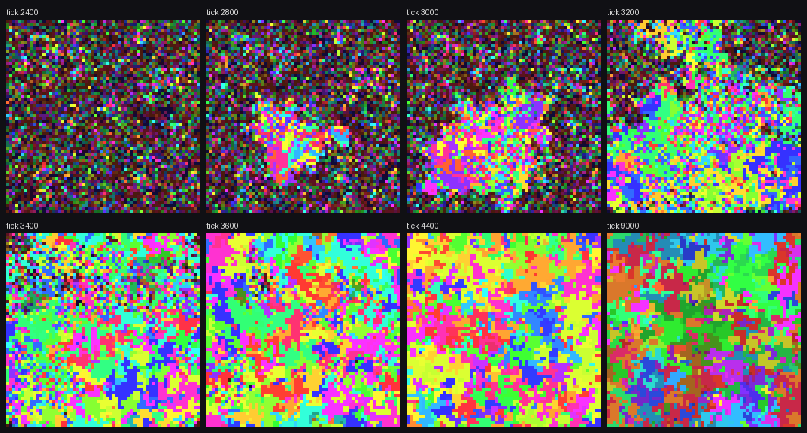

# mini/

Proteus stripped back to its skeleton: programs in cells, a speed of light, and ticks.

This is an experimental sandbox for one question: how does a world's behaviour depend on its laws? It is a separate crate that shares no code with the `v0.4.0` engine in `rust/`, and nothing there has changed. See MINI-SUBSTRATE in `STATUS.md` and `docs/BACKLOG.md` for what is and is not decided.

## The world in full

- The world is a torus of cells. Each cell holds one tape of bytes. The tape is both program and data, and it is the only thing that persists.
- On every tick the cells form disjoint pairs, no further apart than the speed of light. Each pair's tapes are joined end to end and run as one self-modifying program for a bounded number of steps, then split back into their cells.
- After the pairs have run, each byte in the world is replaced by a random byte with a small probability.

A running program has an instruction pointer and two heads. The pointer and head 0 start at the first byte of the joined tapes. The heads wrap around the joined tapes; the pointer does not, and the run ends when it leaves the tape, meets an unmatched bracket, or uses up its steps.

There is no stack, no register that survives a tick, no mass or energy, no maintenance, no lifecycle, no protection and no conflict resolution. Pairs are disjoint, so nothing ever contends.

With the default laws this is BFF ([Agüera y Arcas et al., 2024](https://arxiv.org/abs/2406.19108)) on a nearest-neighbour grid. The interpreter is tested against the replicator published in that paper.

## Instructions

Instructions are the ASCII codes of these characters. Every other byte value is inert data.

| Byte | Effect |
| --- | --- |
| `<` `>` | Move head 0 left or right. |
| `{` `}` | Move head 1 left or right. |
| `-` `+` | Decrement or increment the byte under head 0. |
| `.` | Copy the byte under head 0 to head 1. |
| `,` | Copy the byte under head 1 to head 0. |
| `[` | If the byte under head 0 is zero, jump past the matching `]`. |
| `]` | If the byte under head 0 is nonzero, jump back to the matching `[`. |
| `:` | Copy the byte under head 0 to head 1, then advance both heads. Not part of BFF and off by default. |

## Laws you can vary

Each is a field of `Rules` in `src/lib.rs` and a command-line flag.

| Flag | Law | Default |
| --- | --- | --- |
| `--width`, `--height` | Size of the torus, in cells. | 64 × 64 |
| `--tape` | Bytes per cell. | 64 |
| `--ops` | Which instructions exist, as their characters. | `<>{}-+.,[]` |
| `--steps` | Time: bytes a pair may read as code in one tick. | 8192 |
| `--light` | Speed of light: how far apart two interacting cells may be, in grid steps. `0` removes locality. | 1 |
| `--schedule` | `random`: cells in random order each propose to a random cell in reach, and pair if both are free. `tiling`: a domino tiling that cycles through every offset and orientation, using no randomness. | `random` |
| `--head1` | Whether head 1 starts on the `first` tape of a pair, as in BFF, or on the `second`. | `first` |
| `--mutation-log2` | Each byte mutates with probability `2^-k` per tick; `off` for never. | 12 |
| `--seed` | The initial random soup and all later randomness. | 1 |

A world is a pure function of these laws. Randomness is keyed by seed, tick and cell, so changing one law does not re-roll the noise anywhere else.

## Running it

```bash
cd mini
cargo test
cargo run --release -- --head1 second --seed 3 --after 1000 --sample 100
```

That second command reaches takeoff by tick 2900 and stops 1000 ticks later, in well under a minute. `cargo run --release -- --help` lists every flag.

Each measurement prints one row:

| Column | Meaning |
| --- | --- |
| `tick` | Ticks elapsed. |
| `pairs` | Mean pairs per tick since the last row. |
| `reads`, `ops` | Mean bytes read per pair, and how many of those were instructions. `reads` near the tape length means nothing loops. |
| `shannon` | Entropy of the byte distribution, in bits per byte. |
| `brotli` | Size of the whole world under `brotli -q2`, in bits per byte. |
| `high_order` | `shannon − brotli`: BFF's high-order entropy. Near zero in a random soup; it rises when tapes come to share structure. |
| `kinds` | Distinct instruction skeletons. A tape's skeleton is its instructions with the data removed. |
| `top_share` | Share of cells that carry the most common skeleton. |

"Takeoff" is the first measurement with `high_order` of at least 1 bit (`--takeoff` changes the threshold). The run ends by listing the most common skeletons and a digest of the final state.

`--frames DIR` writes a PNG at each measurement, in which a cell's hue names its skeleton and its brightness grows with its instruction count. `--dump DIR` writes the raw tapes, `width × height × tape` bytes in row order, for analysis elsewhere.



*`--head1 second --seed 3`: a nucleus of replicators appears near tick 2800 and covers the grid by tick 3600. The patches are lineages with different skeletons.*

## First look

Run on 2026-11-11 with crate version 0.1.0. Treat it as orientation, not as a finding.

- **Question and scope:** Which laws decide whether replicators arise from a random soup, and how soon? 64 × 64 worlds unless stated, measured every 100 ticks (every 1000 in the published-BFF rows), with each law changed one at a time.
- **Answer:** Where head 1 starts matters far more than whether a copy instruction exists. Details are in the table.
- **Meaning:** Replication is easy to reach here, which is the opposite of the accessibility concern recorded for `v0.4.0`. Making it easier still is not better: a fused copy instruction can yield worlds that replicate without computing anything.
- **Limits:** Four or eight seeds per row, mostly one grid size, and at most 60,000 ticks. "Not by tick N" does not mean never. Takeoff is a threshold on one metric, and the worlds were observed for only 1000 to 3000 ticks after it.
- **Disposition:** Open and exploratory. Nothing here has been promoted to `docs/analysis/`.

| Laws | Took off | Takeoff tick, median (range) |
| --- | --- | --- |
| BFF as published (the defaults) | 0 of 4 by tick 60,000 | |
| BFF as published, 128 × 128 | 0 of 1 by tick 54,000, when it was stopped | |
| BFF as published, 128 × 128, `--light 0` | 1 of 1 | 53,000 |
| BFF plus `:` (`--ops '<>{}-+.,[]:'`) | 0 of 4 by tick 20,000 | |
| **Base:** BFF with `--head1 second` | 8 of 8 | 8,550 (1,100 to 14,000) |
| Base, `--light 0` | 8 of 8 | 3,500 (1,000 to 17,900) |
| Base, `--schedule tiling` | 8 of 8 | 15,600 (2,900 to 39,600) |
| Base, `--mutation-log2 8` | 8 of 8 | 4,300 (900 to 15,200) |
| Base, `--mutation-log2 off` | 3 of 8 by tick 40,000 | |
| Base, `--steps 512` | 2 of 8 by tick 40,000 | |
| Base plus `:` | 4 of 4 | 200 (all four) |
| Only `[]:`, with `--head1 second` | 4 of 4 | 200 (100 to 200) |

What the winners look like:

- **Base.** Short copy loops, different in every world: `[.>}]`, `.[<{,]`, `.[>{<<,]`. Pairs read thousands of bytes per tick, so the loops are running.
- **Sixteen times the mutation rate.** Seven of eight worlds settle on the same forward copier, `[.}>]`, or a one-instruction variant of it.
- **Base plus `:`.** Mostly bare runs of `:` with no loop. Each `:` copies one byte and moves on, so a tape of them copies itself as the pointer walks across it. A minority carry a `[:]` loop. In two of four worlds pairs read exactly 128 bytes per tick: nothing loops anywhere.
- **BFF as published, without locality.** Long, bracket-heavy programs. The two most common are exact mirror images of each other, which fits the reversed copying the BFF paper reports.

High-order entropy does not tell these apart well. It reads 3.4 to 4.8 bits in the base-plus-`:` worlds 1500 ticks after takeoff, and a median of 6.0 in the base worlds 1000 ticks after. A better measure of interesting behaviour is the open problem; see MINI-SUBSTRATE in `docs/BACKLOG.md`.

To rerun a row, pass its flags and a seed. The base rows used seeds 1 to 8 with `--ticks 40000 --sample 100 --after 1000`. The two rows with `:` and the `[]:` row used seeds 1 to 4 with `--ticks 20000 --sample 100 --after 1500`. The published-BFF rows used seeds 1 to 4 with `--ticks 60000 --sample 1000` at 64 × 64, and seed 1 with `--ticks 250000 --sample 1000 --after 1000` at 128 × 128. Runs are deterministic, so the same flags give the same digest.

## Files

- `src/vm.rs` - the interpreter and the instruction table.
- `src/lib.rs` - the laws (`Rules`) and the world: pairing, running, mutation.
- `src/rng.rs` - counter-based randomness.
- `src/observe.rs` - the census and the PNG renderer. Read-only.
- `src/main.rs` - the command-line runner.
- `tests/vm.rs` - instruction semantics, including the published BFF replicator.
- `tests/world.rs` - determinism, pairing, the speed-of-light bound, and the mutation law.
- `takeoff.png` - the picture above.

## Deliberately absent

These are candidates to add back one at a time, as switchable laws, so that each one's effect can be measured against the same baseline:

- Machine state that survives a tick. Today a pair can copy a whole tape within one tick, so time is not yet a scarce resource.
- Empty cells and movement, so that space is a resource.
- An energy or mass budget.
- A program with a self. The instruction pointer flows from the first tape into the second, so a replicator that runs from the second tape tends to overwrite itself with its partner.
