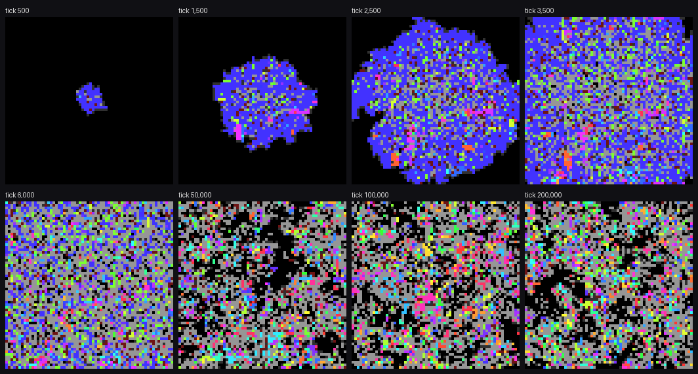

# mini/

Proteus stripped back: programs in cells, mass and energy, one instruction per tick, and death only by wearing out.

This is a quick test bed for a much smaller Proteus, not a replacement for anything. It is a separate crate with no dependencies. It shares no code with the `v0.4.0` engine in `rust/`, and nothing there has changed. See MINI-PROTEUS in `STATUS.md` and `docs/BACKLOG.md` for what is decided and what is provisional.

## The world in full

A world is a torus of cells. Each cell holds loose energy, loose mass, and at most one body. A body is a string of instructions and is either a live program or a child still being built. Each instruction is one unit of mass.

A live program has four pieces of state besides its code: an instruction pointer, the direction it faces, a copy cursor, and one general register `A`. It also holds energy and mass of its own.

Each tick, in this order:

1. **Execute.** Every program that is live as the tick begins executes exactly one instruction. Code is a loop: after the last instruction comes the first.
2. **Copy.** Every `copy` executed this tick is judged against the world as it stood before any of them landed. Then the winners land.
3. **Slip.** The instruction a program just executed is replaced by a different random value with probability `2^-slip`.
4. **Upkeep.** Each instruction of each live program costs 1 energy with probability `2^-upkeep`. For each unit the program cannot pay, its last instruction dissolves into the cell as loose mass. A program with no instructions left is dead: the energy and mass it held return to its cell.
5. **Weather.** Every unit of loose energy and mass, lying in a cell or held by a program, dissipates with probability `2^-decay`. Then new energy and mass arrive in every cell.

Nothing attacks anything, and nothing moves. A cell is freed only when its program wears out.

## Instructions

Eight instructions in a four-bit code. The other eight values are no-ops, so a mutation is as likely to silence an instruction as to turn it into another. `A` is four bits wide, like an instruction, and holds 0 to 15.

| Value | Letter | Name | Effect |
| --- | --- | --- | --- |
| 0 | `A` | absorb | Take all loose energy in this cell. |
| 1 | `C` | collect | Take all loose mass in this cell. |
| 2 | `K` | copy | Extend the child in the facing cell with the instruction under the cursor. Costs 1 energy and 1 mass. |
| 3 | `T` | turn | Face the next cell clockwise. |
| 4 | `L` | look | Set `A` to the size of the live program in the facing cell, or 0 if there is none. |
| 5 | `W` | weigh | Set `A` to the mass this program holds. |
| 6 | `D` | dec | Subtract 1 from `A`, stopping at 0. |
| 7 | `S` | skip | Skip the next instruction if `A` is 0. |
| 8 to 15 | `.` | no-op | Nothing. |

Only `copy` and upkeep cost energy. Executing any other instruction is free.

### How copying works

- A `copy` into an empty cell starts a new child there, from the first instruction.
- A `copy` into the cell holding the program's own unfinished child extends it. The cursor advances only when the copy succeeds, so a copy that cannot be paid for, or is blocked, costs nothing and loses nothing.
- When the cursor passes the end of the parent's code, the child wakes with empty pockets, facing a random direction, and starts executing on the next tick.
- A program builds one child at a time. If it starts a child somewhere else, or dies, the unfinished one dissolves into loose mass where it lies.
- An occupied cell accepts a copy only from the program building the child in it. If several programs want the same empty cell on the same tick, one is chosen at random.
- An unfinished child does not execute, pays no upkeep, and does not decay.
- A copy goes wrong with probability `2^-miscopy`. Half of the errors write a wrong instruction, a quarter skip an instruction, and a quarter repeat one.

## Laws you can vary

Each is a field of `Laws` in `src/lib.rs` and a command-line flag. A rate `K` means a probability of `2^-K`, and may be `off`.

| Flag | Law | Default |
| --- | --- | --- |
| `--width`, `--height` | Size of the torus, in cells. | 64 × 64 |
| `--energy-rate` | Mean energy arriving per cell per tick. | 0.25 |
| `--mass-rate` | Mean mass arriving per cell per tick. | 0.05 |
| `--decay-log2` | Loose energy and mass dissipate. | 7 |
| `--upkeep-log2` | Each instruction costs 1 energy. | 7 |
| `--slip-log2` | An executed instruction mutates. | 10 |
| `--miscopy-log2` | A copy goes wrong. | 7 |
| `--seed` | All randomness. | 1 |

The arrival rates, decay and upkeep are the `v0.4.0` defaults. A world is a pure function of its laws and its start. Randomness is keyed by seed, tick and cell, so changing one law does not re-roll the noise anywhere else.

## Running it

```bash
cd mini
cargo test
cargo run --release -- --ticks 20000 --sample 1000
```

The default start is one program, `ACKLST`, in the middle of the world: absorb, collect, copy, then look ahead and turn only if a live program is in the way. `--start CODE` plants different code, and `--soup N` instead fills every cell with random code of length `N`. `cargo run --release -- --help` lists every flag.

Each measurement prints one row:

| Column | Meaning |
| --- | --- |
| `live`, `unfinished` | Live programs, and children under construction. |
| `whole` | Live programs whose code has `absorb`, `collect` and `copy`. This is necessary for breeding, not sufficient. |
| `squatters` | Live programs that have `absorb` but lack `collect` or `copy`: they feed and cannot breed. |
| `starving` | Live programs with no `absorb`. |
| `births`, `deaths` | Since the previous row. |
| `lifespan`, `children` | Mean age and mean completed children of the programs that died since the previous row. |
| `size`, `generation` | Mean instructions and mean number of ancestors per live program. |
| `species`, `top_share` | Distinct codes among whole programs, and the share of the most common. |

`--frames DIR` writes a PNG at each measurement. Empty cells are black, unfinished children dark grey, squatters light grey and starving programs dark red. A whole program's hue names its code.



*The default world. The seed's colony fills the grid by about tick 3,500. After that squatters (grey) and empty gaps (black) persist while coloured lineages keep turning over.*

## First look

Run on 2026-11-12 with crate version 0.1.0. Treat it as orientation, not as a finding.

- **Question and scope:** With no attack, movement or displacement, does mutation alone make room? 64 × 64 worlds run for 200,000 ticks, each changing one thing from the defaults. One world per row, except the default, which has three seeds.
- **Answer:** Yes, with a standing cost. With slips off the world fills and freezes. With slips on there is steady turnover and descent continues for the whole run, but 56% to 65% of live programs are squatters at any moment, whatever the slip rate.
- **Meaning:** The slip rate sets the tempo of the world and not the squatter share. That share looks structural: more mutations make a program sterile than make it starve.
- **Limits:** One world per row except the default. `whole` overstates the breeders. The reasons given below for what evolved are guesses that no run here tests.
- **Disposition:** Open and exploratory. Nothing here has been promoted to `docs/analysis/`.

All columns are read at tick 200,000. Births are for the last 10,000 ticks.

| World | Live programs | Squatters, share of live | Births | Mean generation | Mean size |
| --- | --- | --- | --- | --- | --- |
| Default, seed 1 | 2,763 | 58% | 2,985 | 124 | 7.4 |
| Default, seed 2 | 2,440 | 59% | 3,435 | 146 | 6.3 |
| Default, seed 3 | 2,825 | 57% | 2,850 | 134 | 7.6 |
| `--slip-log2 12` | 3,319 | 64% | 1,041 | 59 | 6.2 |
| `--slip-log2 14` | 3,593 | 62% | 297 | 38 | 6.0 |
| `--slip-log2 off` | 4,091 | 1% | 0 | 35 | 6.0 |
| `--miscopy-log2 off` | 2,938 | 56% | 4,571 | 189 | 5.3 |
| `--upkeep-log2 5` | 2,714 | 65% | 6,400 | 336 | 3.8 |
| `--mass-rate 0.25` | 2,657 | 57% | 2,255 | 178 | 8.7 |
| `--soup 6` | 2,667 | 59% | 2,408 | 126 | 7.8 |
| `--start ACK` | extinct after 3 births | | | | |
| `--soup 3` | extinct by tick 50,000 | | | | |

Other things seen:

- **Squatters are mostly former breeders.** In the default world at tick 200,000, 932 of the 1,605 squatters had completed a child before going sterile. Their mean age was 13,337 ticks, against 5,608 for whole programs.
- **Replicators arise from random code.** The soup of random six-instruction programs reaches the same state as the seeded worlds with no seed at all.
- **A program has to turn.** `ACK` builds in one direction only, and its line died out. The smallest programs that persist have four instructions: under four times the upkeep, the four orderings `ATCK`, `ACKT`, `ACTK` and `AKTC` make up about half of the whole programs.
- **The seed's look-and-skip logic disappears.** At tick 200,000 at most 4 live programs in each default world still contain `LST`. Evolved programs such as `KATC` and `KKCAT` turn on every lap. That works in a crowded world because a copy into an occupied cell fails without abandoning the child being built elsewhere.
- **Code fills with no-ops unless upkeep is high.** In the three default worlds the mean program goes from 6 real instructions and no no-ops to between 4.2 and 4.7 real instructions and between 2.2 and 2.9 no-ops.

## Files

- `src/code.rs` - the instruction set and its spelling.
- `src/lib.rs` - the laws and the tick.
- `src/rng.rs` - counter-based randomness.
- `src/observe.rs` - the census and the PNG renderer. Read-only.
- `src/main.rs` - the command-line runner.
- `tests/laws.rs` - one test or more per law.
- `world.png` - the picture above.
